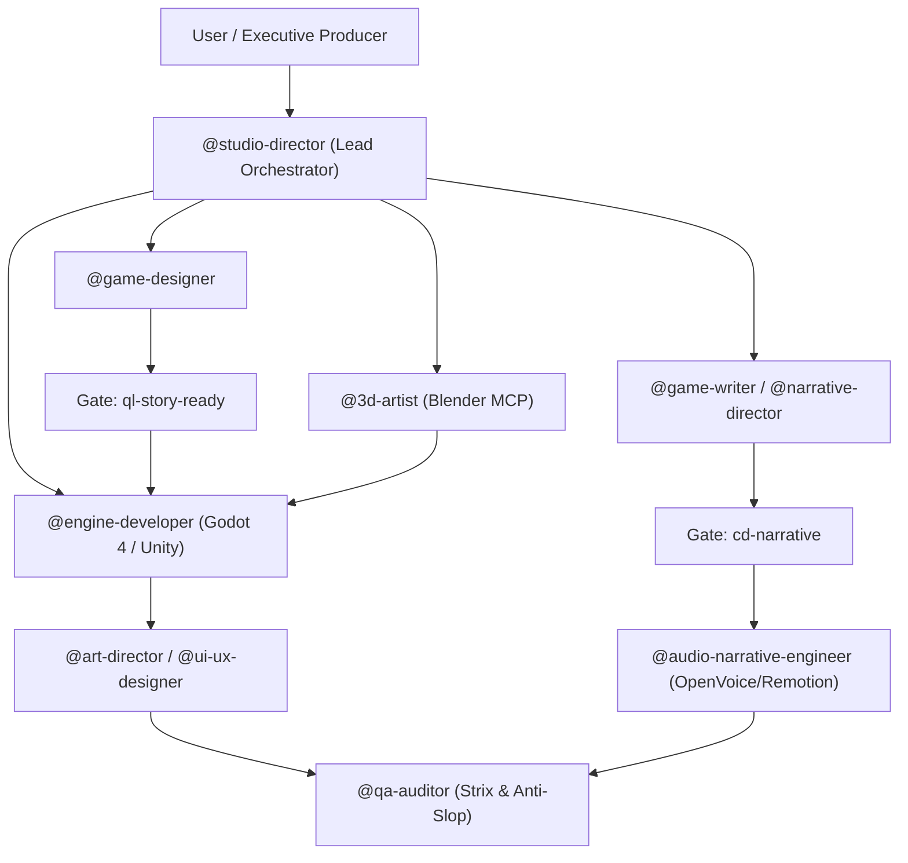

# Multi-Agent Coordination Protocol & System Architecture (`AGENTS.md`)
# Framework: pamirtuna/gamestudio-subagents & Claude-Code-Game-Studios

This document defines the agent roles, hierarchy, interaction contracts, and execution pipelines for AI agents operating within **Master Game Studio Skills**.

---

## 🏛️ 1. Orchestration Model & Hierarchy



---

## 🛠️ 2. Sub-Agent Role Matrix

| Sub-Agent | Scope & Skill Reference | Input | Deliverable / Output |
|---|---|---|---|
| **`@studio-director`** | `skills/01-architecture-&-core/studio-director.md` | User pitch, `/brainstorm` input | Feature breakdown (F00..Fn), `i-have-adhd` task slices |
| **`@game-writer`** | `skills/02-narrative-&-world/narrative-rules.md` | Quest briefs, character bibles | Subtext dialogues (<= 120 chars), conlang lexicons, branching trees |
| **`@game-designer`** | `skills/03-game-design/design-core.md` | Gameplay hooks, balance targets | TTK curves, `graphify` trees, `modly` JSON asset definitions |
| **`@3d-artist`** | `skills/04-blender-3d-artist/3d-pipeline.md` | Concept briefs, mesh budgets | Headless Blender `bpy` scripts, modular `.gltf` props |
| **`@engine-developer`** | `skills/05-game-engine-dev/vertical-slice.md` | Feature specs, 3D meshes | 15-min vertical slice scenes, GDScript controllers, GridMaps |
| **`@art-director`** | `skills/06-ui-ux-graphics/hud-and-2d.md` | UI briefs, theme palettes | HUD layouts, AAA contrast specs, `mcptoon` 2D art |
| **`@audio-narrative-engineer`**| `skills/07-audio-narrative/multimedia-pipeline.md` | Approved dialogue scripts | OpenVoice audio files, Remotion React video cutscenes |
| **`@qa-auditor`** | `skills/08-qa-security-audit/audit-pipeline.md` | Engine scripts, narrative docs | Strix security vulnerability reports, anti-slop checks |

---

## 📜 3. Cross-Agent Data Contracts

### Narrative Dialogue Node Contract (JSON)
```json
{
  "node_id": "DLG_KHOR_01",
  "speaker": "Kaelen",
  "lore_tier": "[Established]",
  "dialogue_text": "The gate mechanism requires fresh oil. Don't touch the brass lever.",
  "character_count": 67,
  "next_node": "DLG_KHOR_02"
}
```

### 3D Asset Manifest Contract
```json
{
  "asset_id": "prop_modular_chest",
  "category": "prop",
  "triangle_count": 820,
  "materials": ["M_Chest_Stylized"],
  "export_file": "modular_chest.gltf",
  "bounding_box": [1.4, 0.9, 0.75]
}
```
