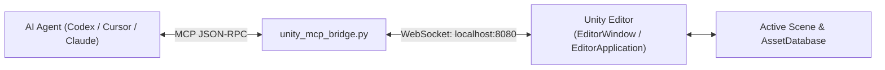

# Unity MCP Connector Skill

The **Unity MCP Connector** bridges AI agent capabilities with the Unity Editor runtime. It enables real-time scene inspection, procedural scene assembly, automated component configuration, and Playmode test execution.

---

## 1. Architecture & Protocol



The Unity Editor integration runs on the editor thread via `EditorApplication.update` callbacks, ensuring that all operations are thread-safe and properly recorded within Unity's `Undo` system.

---

## 2. Standard MCP Tools Exposed

### `unity_get_scene_hierarchy`
Retrieves the complete or scoped GameObject hierarchy of the open scene.
- **Input:**
  ```json
  {
    "root_only": true,
    "include_components": true
  }
  ```
- **Output:**
  ```json
  {
    "active_scene": "MainLevel",
    "root_count": 2,
    "game_objects": [
      {
        "instance_id": 1024,
        "name": "Directional Light",
        "components": ["Transform", "Light"]
      }
    ]
  }
  ```

### `unity_instantiate_prefab`
Loads an asset from `Assets/` and instantiates it into the active scene.

### `unity_refresh_asset_database`
Forces Unity to re-import newly created external files (glTF, textures, scripts).

### `unity_run_playmode_test`
Enters Playmode, executes designated unit or integration test suites, and returns results.

---

## 3. Usage

```bash
python mcp-connectors/unity-mcp/unity_mcp_bridge.py --port 8080
```
