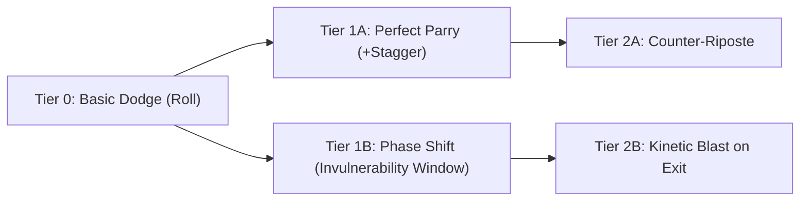

# Game Design Core: Mechanics, Balance & Modular Systems (`design-core.md`)
# Sub-Agent Domain: @combat-designer, @level-designer, @economy-designer
# Integrations: graphify (progression state graphs), modly (modular data binding)

## 1. Tactical Combat Loops & TTK Formulas
Game combat is tuned around the **5-Second Satisfaction Loop**:

```text
Telegraph (0.4s - 0.8s) --> Reaction Window (0.2s - 0.5s) --> Impact & Juice (0.1s - 0.3s) --> Recovery / Reposition
```

### Time-to-Kill (TTK) Metrics
- **Minion / Grunt:** 1.2s – 2.0s TTK (2–3 precise hits)
- **Elite / Bruiser:** 6.0s – 10.0s TTK (requires vulnerability exploitation or parry)
- **Boss Encounter:** 180s – 300s across 2–3 phase transitions

### Damage Formula Standard
```python
def calculate_damage(base_attack: float, armor_rating: float, multiplier: float = 1.0) -> float:
    # Diminishing returns armor formula preventing invulnerability
    damage_reduction = armor_rating / (armor_rating + 100.0)
    effective_damage = base_attack * (1.0 - damage_reduction) * multiplier
    return max(1.0, round(effective_damage, 2))
```

---

## 2. Graphify Progression Architecture
Character advancement and ability trees are modeled as directed acyclic graphs (DAGs) using `graphify`:



- **Graph Validation Rule:** Every node must have at least one viable prerequisite and clear mechanical counter-weight (e.g. higher stamina cost for higher invulnerability frames).

---

## 3. Modly Data Binding for Modular Assets
`modly` connects design spreadsheets/data structures directly to engine resources.

```json
{
  "modly_item_id": "WPN_KHOR_SWORD_01",
  "category": "Melee_Slashing",
  "base_stats": {
    "damage": 24,
    "swing_speed": 1.25,
    "stamina_cost_per_swing": 18,
    "poise_damage": 35
  },
  "asset_bindings": {
    "blender_mesh": "res://assets/weapons/khor_sword_01.gltf",
    "collision_shape": "res://assets/weapons/khor_sword_01_col.tres",
    "hit_vfx": "res://vfx/sparks_slash.tscn",
    "sound_impact": "res://audio/sfx/metal_flesh_impact.ogg"
  }
}
```
