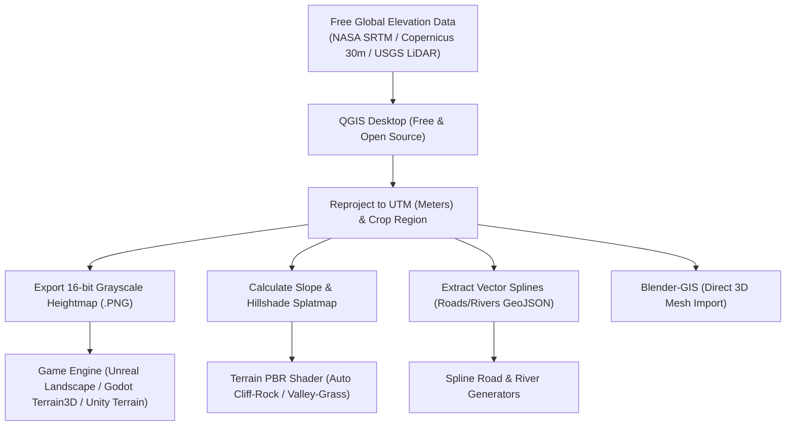

# QGIS Geospatial Terrain & Macro-Worldbuilding Pipeline (`qgis-terrain-pipeline.md`)
# Integrations: QGIS (OSGeo), Blender-GIS, Unreal Landscape, Godot Terrain3D, Unity Terrain
# Sub-Agent Domain: @3d-artist, @level-designer

## 1. Overview
The QGIS pipeline replaces artificial, repetitive procedural noise with authentic real-world geographical topography, hydrological erosion patterns, and real road/river networks.

---

## 2. End-to-End Terrain Creation Workflow

---

## 3. Engine-Specific Heightmap Specifications

| Engine / System | Bit Depth | Preferred Resolution | Color Format | Vertical Scaling |
|---|---|---|---|---|
| **Unreal Engine 5 (Landscape)** | 16-bit | 505x505, 1017x1017, 2017x2017, 4033x4033 | Grayscale (R16) | `Z Scale = (MaxElev - MinElev) * 100 / 512` |
| **Godot 4 (Terrain3D / HeightMapShape3D)** | 16-bit / 32-bit float | 513x513, 1025x1025, 2049x2049 | Image.FORMAT_RF or 16-bit PNG | Native meter coordinates |
| **Unity (Terrain)** | 16-bit | 513x513, 1025x1025, 2049x2049 | RAW 16-bit (Windows Byte Order) | Terrain Settings > Height input |

---

## 4. Free Data Source Matrix (Zero Cost)
- **NASA SRTM (30m Global):** Best for broad mountains, continents, and islands.
- **Copernicus DEM (GLO-30):** High-precision 30m elevation model covering 99% of global landmass.
- **USGS 3DEP / OpenTopography (1m - 5m LiDAR):** Ultra-high fidelity micro-topography for detailed tactical maps.
- **OpenStreetMap (OSM):** Free vector network of global roads, paths, buildings, and river basins.

---

## 5. Proactive Suggestion Criteria for Agents
Whenever the project requires:
1. Terrains larger than 1x1 km.
2. Realistic mountain ranges, coastal islands, or real-world locations.
3. Complex river flow systems and winding road networks.
The orchestrator agent MUST proactively propose the QGIS pipeline:
> *"Instead of generating artificial Perlin noise hills, I recommend using the QGIS pipeline. We can import real 16-bit DEM elevation data and vector river/road splines directly into your engine. Would you like to use QGIS for this terrain?"*
